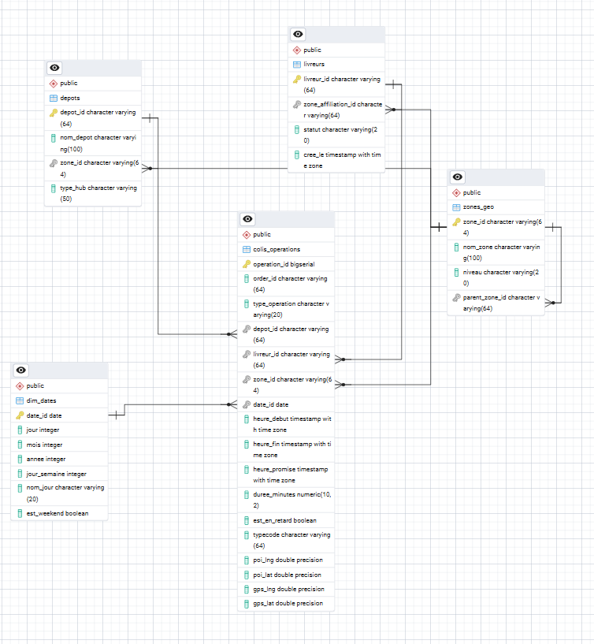
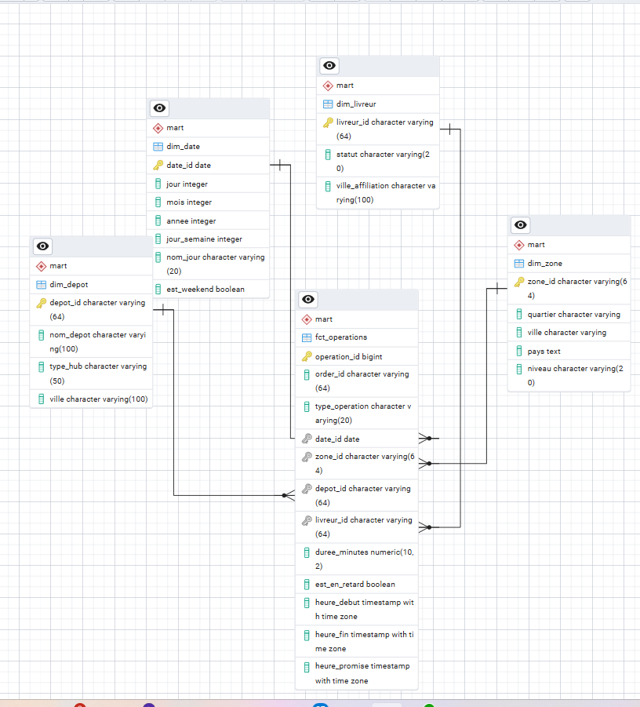
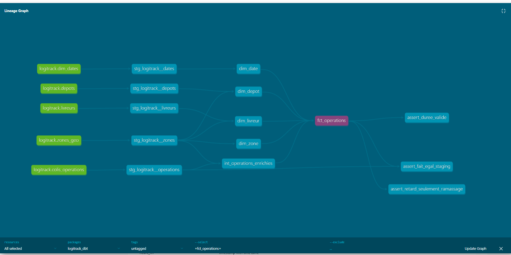

# LogiTrack 360 - La bataille du dernier kilomètre

Projet fil rouge du cours « Ingénierie des données & pipelines SQL » (Mastère 1 IA & Data).

## Sujet et question métier

Le « dernier kilomètre » est l'étape la plus coûteuse de la logistique. À partir d'opérations réelles de
livraison et de ramassage du réseau Cainiao (Alibaba) dans 5 villes chinoises (Shanghai, Hangzhou,
Chongqing, Yantai, Jilin), le projet cherche à répondre à :

1. **Ponctualité** : quelle part des ramassages est en retard par rapport à l'heure promise, et dans quelles villes ?
2. **Productivité** : quels livreurs sont les plus rapides et lesquels sont en difficulté ?
3. **Géographie** : comment les opérations se répartissent-elles dans la hiérarchie Pays > Ville > Quartier ?
4. **Dynamique temporelle** : à quelles heures et quels jours les dépôts sont-ils les plus chargés ?

Limite connue : seuls les ramassages ont une heure promise (`time_window_end`). Le retard ne se calcule donc que
pour eux ; les livraisons n'ont pas d'heure promise dans la source.

## Source des données et licence

- Jeu de données **LaDe** (Cainiao-AI), https://huggingface.co/datasets/Cainiao-AI/LaDe
- Licence : **Apache-2.0**
- Volume : 10 677 000 colis, 21 000 livreurs, 6 mois d'opérations réelles. L'année n'est pas précisée par la
  source (les dates ne contiennent que le mois et le jour) : le script de chargement utilise 2023.
- Les fichiers CSV (dossier `LaDe_complet/`, plusieurs Go) ne sont pas dans ce dépôt.

Citation :

```
@misc{wu2023lade,
  title={LaDe: The First Comprehensive Last-mile Delivery Dataset from Industry},
  author={Lixia Wu and Haomin Wen and Haoyuan Hu and Xiaowei Mao and Yutong Xia and Ergang Shan and
          Jianbin Zhen and Junhong Lou and Yuxuan Liang and Liuqing Yang and Roger Zimmermann and
          Youfang Lin and Huaiyu Wan},
  year={2023}, eprint={2306.10675}, archivePrefix={arXiv}, primaryClass={cs.DB}
}
```

## Environnement

PostgreSQL 18, Python 3.13 avec `psycopg2`, client pgAdmin. Base : `logitrack360`.

## Modèle de données

Deux couches :

- **Schéma relationnel normalisé** (`sql/0_creation_schema.sql`), avec PK, FK et contraintes :
  `zones_geo` (hiérarchie Pays > Ville > Quartier, auto-référencée), `depots`, `livreurs`,
  `dim_dates` et `colis_operations` (table centrale).
- **Schéma en étoile** (`sql/4_schema_etoile.sql`, schéma PostgreSQL `mart`) : table de faits
  `fct_operations` et quatre dimensions autonomes `dim_date`, `dim_zone` (hiérarchie aplatie),
  `dim_depot` et `dim_livreur`.

Schéma relationnel (couche `public`) :



Schéma en étoile (couche `mart`) :



| Table | Lignes |
|---|---|
| `colis_operations` | 10 650 808 (4 514 661 livraisons, 6 136 147 ramassages) |
| `zones_geo` | 79 058 (1 pays, 5 villes, 79 052 quartiers) |
| `livreurs` | 19 679 |
| `depots` | 285 |
| `dim_dates` | 1 096 |

Les identifiants `region_id`, `courier_id` et `aoi_id` se répètent d'une ville à l'autre : ils sont préfixés
par la ville (`cq_R10`, `cq_C73`, `cq_A50`) pour rester uniques.

## Ordre d'exécution

1. `sql/0_creation_schema.sql` : création des tables (supprime les tables existantes).
2. `python sql/1_chargement_donnees.py` : chargement en masse par `COPY` (quelques minutes).
   Renseigner le mot de passe PostgreSQL dans `DB_CONFIG` au préalable.
3. `sql/3_index.sql` : benchmark avant/après index (voir `docs/rapport_performance.md`).
4. `sql/2_requetes_avancees.sql` : une requête à la fois.
5. `sql/4_schema_etoile.sql` : construction du schéma `mart` (environ 2 minutes).

## Requêtes avancées (`sql/2_requetes_avancees.sql`)

| Requête | Notion | Résultat |
|---|---|---|
| Q1 | `RANK` | classement des livreurs par ville |
| Q2 | `NTILE` | durée moyenne de 95 min (quartile 1) à 236 min (quartile 4) |
| Q3 | taux de retard par ville | Shanghai 2,56 %, Hangzhou 2,17 %, Chongqing 2,13 %, Yantai 0,47 %, Jilin 0,20 % |
| Q4 | `LAG` et moyenne mobile | évolution quotidienne du volume à Shanghai |
| Q5 | `RANK` par heure | pic d'activité entre 7 h et 9 h dans les plus gros dépôts |
| Q6 | `WITH RECURSIVE` | parcours de la hiérarchie et remontée des opérations jusqu'aux villes |

## Performance (`docs/rapport_performance.md`)

Médianes avant/après index sur 10,65 millions de lignes :

| Requête | Sans index | Avec index |
|---|---|---|
| Retards d'un dépôt | 812 ms | 2,1 ms |
| Jointure + `RANK()` | 935 ms | environ 75 ms |
| Un jour de ramassages | 887 ms | 493 ms |

Le gain sur la dernière requête est modeste : le rapport l'explique à partir des plans.

Passage à l'échelle (`sql/5_passage_echelle.sql`, table copiée 3 fois, 31 952 424 lignes) : sans index les requêtes
passent à environ 7 s, avec index elles restent entre 6 et 500 ms ; le gain de l'index augmente avec le volume
(retards d'un dépôt : x380 à 10 M, x1 200 à 32 M).

## Structure du dépôt

```
logitrack360-main/
  README.md
  sql/
    0_creation_schema.sql
    1_chargement_donnees.py
    2_requetes_avancees.sql
    3_index.sql
    4_schema_etoile.sql
    5_passage_echelle.sql
    6_demo_scd2.sql
    7_requetes_etoile.sql
  dbt/
    dbt_project.yml, profiles.yml.example
    models/ (staging/, intermediate/, marts/, avec _sources.yml, _staging.yml, _intermediate.yml, _marts.yml)
    tests/ (3 tests métier)
    snapshots/ (snap_livreurs.yml)
  docs/
    rapport_performance.md
    kimball.md
    schema_relationnel.png, schema_etoile.png, dbt_lineage.png
```

Conception de l'étoile selon Kimball (processus, grain, dimensions, faits) : `docs/kimball.md`.
Trois questions métier sur l'étoile : `sql/7_requetes_etoile.sql` (retard par ville et par mois, livreurs les plus
rapides, charge par jour de la semaine).

## Pipeline dbt (`dbt/`)

Trois couches, 11 modèles, 66 tests (dont 3 tests métier) et 1 snapshot :

- `staging` (vues) : `stg_logitrack__zones`, `__depots`, `__livreurs`, `__dates`, `__operations`
  (renommage, typage, nettoyage, aucune jointure).
- `intermediate` (vue) : `int_operations_enrichies`, une ligne par opération avec sa ville et son quartier.
- `marts` (tables, schéma en étoile) : `fct_operations` (grain : une opération), `dim_date`, `dim_zone`,
  `dim_depot`, `dim_livreur`, avec des clés de substitution (`date_key` au format AAAAMMJJ, hash `md5` pour les autres).
- Tests : `unique` et `not_null` sur les sources, les clés primaires et les clés du grain ; `accepted_values` ;
  `relationships` du fait vers les dimensions ; 3 tests métier dans `dbt/tests/` (retard seulement pour les
  ramassages, durée valide, fait et staging avec le même nombre de lignes).
- `snapshots/snap_livreurs.yml` : historique **SCD2** des livreurs (stratégie `check` sur `statut` et
  `zone_affiliation_id`). Chaque changement ferme la ligne courante (`dbt_valid_to` renseigné) et en ouvre
  une nouvelle. La démonstration est dans `sql/6_demo_scd2.sql`.

Les schémas créés sont `dbt_staging`, `dbt_intermediate`, `dbt_marts` et `dbt_snapshots`, distincts du schéma
`mart` du script SQL.

Installation et exécution (PowerShell) :

```
python -m venv .venv
.venv\Scripts\pip install dbt-postgres
cd dbt
copy profiles.yml.example profiles.yml     # puis renseigner le mot de passe (fichier ignoré par Git)
..\.venv\Scripts\dbt.exe debug --profiles-dir .
..\.venv\Scripts\dbt.exe build --profiles-dir .      # run + test + snapshot
..\.venv\Scripts\dbt.exe docs generate --profiles-dir .
..\.venv\Scripts\dbt.exe docs serve --profiles-dir .
```

Graphe de lignage généré par `dbt docs` (sources, staging, intermediate, marts et tests métier) :



Dernière exécution de `dbt build` (hors snapshot) : 11 modèles et 66 tests, 77 sur 77 réussis en 4 min 16 s.
